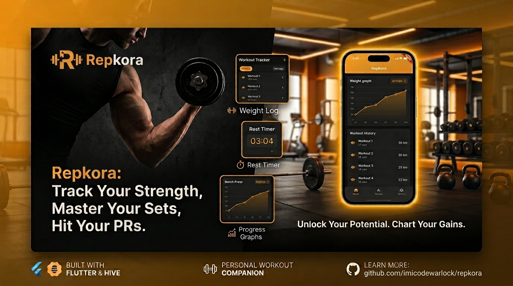

# 🏋️‍♂️ Repkora

> *A personal workout companion built to replace messy notes and generic tracking apps with a clean, offline-first experience.*

---

## 🌟 Story Behind the Project

As someone passionate about fitness, I constantly found myself struggling with over-complicated workout apps filled with ads, paywalls, or cluttered interfaces. I simply wanted a fast, reliable tool to track my weights, time my rest intervals, and see my strength gains over time right from my phone.

So, I decided to code my own solution: **Repkora**.

I built Repkora to solve my personal gym needs—a distraction-free digital vault that securely stores every set, rep, and weight lifted, helping me stay focused and consistent with my fitness goals.

---

## ✨ Key Features

- **📊 Comprehensive Workout Logging:** Easily log sets, reps, and weights with an intuitive, minimalist user interface.
- **⏱️ Integrated Rest Timer:** Smart audio-visual feedback to manage rest intervals between sets seamlessly.
- **📈 Dynamic Analytics & Graphs:** Beautiful interactive charts (powered by `fl_chart`) tracking strength progress and volume over time.
- **🌐 Multi-Language Support (i18n):** Full internationalization support generated via `flutter_gen` for 5 languages:
   - English (`app_en.arb`)
   - Arabic (`app_ar.arb`)
   - French (`app_fr.arb`)
   - Spanish (`app_es.arb`)
   - Italian (`app_it.arb`)
- **🔒 Offline-First & Private:** Fast local data persistence powered by **Hive** and `shared_preferences`. Your fitness data stays on your device.
- **🎨 Modern Dark Design:** High-contrast, vibrant UI tailored for low-light gym environments.

---

## 🛠️ Architecture & Tech Stack

- **Framework:** [Flutter](https://flutter.dev/) (Targeting iOS & Android)
- **State Management:** [BLoC / Cubit](https://pub.dev/packages/flutter_bloc) for predictable state flow and clear separation of concerns.
- **Local Database:** [Hive](https://pub.dev/packages/hive) for lightning-fast key-value storage.
- **Localization:** Official Flutter `.arb` approach with `flutter_gen`.
- **Audio Feedback:** [audioplayers](https://pub.dev/packages/audioplayers) for timer alerts.

---

## 🚀 Getting Started

### Prerequisites

Ensure you have the Flutter SDK installed on your system.
- Flutter SDK `>=3.0.0`
- Dart SDK `>=3.0.0`

### Installation

1. **Clone the repository:**
   ```bash
   git clone https://github.com/imicodewarlock/repkora.git
   cd repkora
   ```

2. **Install dependencies:**
   ```bash
   flutter pub get
   ```

3. **Generate Localizations and Code Assets:**
   ```bash
   flutter gen-l10n
   flutter pub run build_runner build --delete-conflicting-outputs
   ```

4. **Run the Application:**
   ```bash
   flutter run
   ```

---

## 🧪 Testing

Run the full test suite (including widget, logic, and unit tests):

```bash
flutter test
```

---

## 📱 How to Use Repkora

1. **Log an Exercise:** Tap the `+` button on the main screen to enter your exercise details (Name, Sets, Reps, Weight, and Rest Time).
2. **Start Your Rest Timer:** After completing a set, press the ▶️ button next to your exercise to trigger your rest timer.
3. **Analyze Progress:** Tap the chart icon in the upper right header to view your strength progression curve over time.
4. **Manage Entries:** Tap the trash icon on any exercise card to clear old or unwanted logs.

---

## 📄 License

This project is open-source and available under the [MIT License](LICENSE).

<p align="center">
  <i>Built with dedication for personal growth and consistent training. 🏋️‍♂️💪</i>
</p>